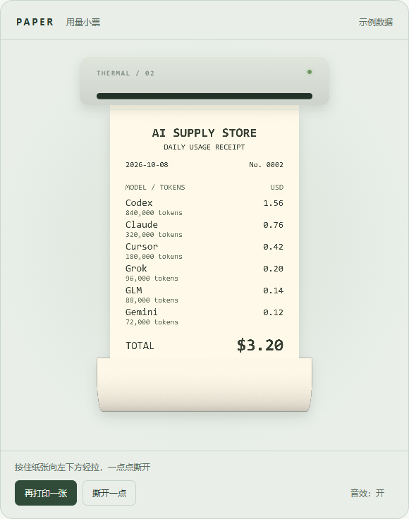

# Paper Receipt Demo

一个可以在浏览器里体验的拟物小票交互：分段打印、长纸卷曲，以及沿着纸张边缘一点点撕开的动画。

使用原生 **HTML、CSS、JavaScript、Canvas 2D 和 WebGL** 实现。无需安装依赖或执行构建，打开页面即可运行。



## 功能

- **分段走纸**：每推进一段短暂停顿，包含轻微的加速和减速。
- **同步打印音效**：纸张推进时响起，停顿时停止。
- **长纸卷曲**：纸张末端弯向正面，呈现背面、透视、光照和阴影。
- **渐进撕裂**：轻拉只撕开一小段，松手保留裂口，再次拖动继续撕。
- **局部纸张形变**：未断开的部分保持连接，已撕开的部分随拖动弯曲、下垂。
- **松手回弹和落纸**：释放拉力后纸张回弹；裂口贯穿纸宽后，小票脱离打印口。
- **鼠标和触屏操作**：统一使用 Pointer Events，并提供“撕开一点”按钮作为键盘操作入口。
- **浅色／深色模式**：跟随系统外观；支持减少动态效果设置。
- **本地状态保存**：使用浏览器 localStorage 保存音效开关、打印状态与裂口进度。

## 快速开始

### 直接打开

下载项目，将 `index.html`、`styles.css` 和 `app.js` 保持在同一目录，使用浏览器打开 `index.html`。

页面运行不依赖网络、CDN、后端服务或 API Key。音效在用户点击后启用。

### 通过本地服务器运行

如果电脑上已经安装 Python，可以在项目目录运行：

```bash
python -m http.server 8000 --bind 127.0.0.1
```

然后访问 [http://127.0.0.1:8000](http://127.0.0.1:8000)。按 `Ctrl+C` 停止服务器。

Python 仅用于启动可选的本地服务器，动画本身完全在浏览器中执行。

## 操作方法

1. 点击 **打印长小票**，观察分段出纸与停顿。
2. 打印完成后，按住纸张，向左下方轻拉。
3. 松手后裂口会保留，继续拉动可以扩大裂口。
4. 裂口贯穿整个纸宽时，小票会完全脱离。
5. 点击 **再打印一张** 重新开始；点击 **音效：开／关** 切换声音。

也可以点击 **撕开一点**，每次推进约 10% 的撕裂进度。

## 项目结构

```text
paper-receipt-demo/
├── index.html       # 页面结构、按钮与可访问性描述
├── styles.css       # 打印机外观、主题与响应式布局
├── app.js           # 纹理、网格、手势、动画、音效及本地状态
├── assets/
│   └── preview.png  # 实际运行截图
├── README.md
├── .gitignore
└── .nojekyll        # GitHub Pages 直接发布静态文件
```

## 实现原理

### 小票内容与纸张纹理

`buildTexture()` 使用离屏 Canvas 2D 绘制文字、金额、条形码和细微纸张颗粒，再将画布作为 WebGL 纹理。

目前展示的是固定的示例账单。模型名称、Token 数量、日期、费用、缓存比例和总额都在该函数中绘制，修改时需要一起更新；总额目前不会自动求和。条形码也属于装饰图案。

### 卷曲与形变

纸张由网格组成。`point(u, v)` 根据打印进度、拖动位移和裂口进度，计算顶点的位置及透视投影。

末端采用圆弧曲面模拟卷纸；正面使用小票纹理，背面显示纸色与颗粒。WebGL 利用深度测试处理卷曲区域的遮挡，并依据曲面方向调整明暗。WebGL 不可用时，会尝试 Canvas 2D 三角形纹理绘制，光照细节和性能与 WebGL 模式不同。

### 分段打印

`printSample()` 根据时间计算当前是推进阶段还是暂停阶段。每段推进过程包含短暂的加速和减速；暂停期间，打印进度保持不变。`syncPrintSound()` 使用同一个阶段信息控制打印音效。

默认节奏为 **8 段**：每段推进约 **70 个逻辑像素**，推进用时 **300 毫秒**，段间暂停 **120 毫秒**。最后一段完成后不再追加停顿，总时长约 **3.24 秒**。

### 渐进撕裂

拖动距离累计转换为裂口进度。`advanceTo()` 只接受大于已有进度的值，因此反向移动或松手不会让裂口恢复。

未撕开的顶部区域保留连接，已撕开的区域产生局部开口和弯曲。拖动跟随和回弹使用弹簧积分；裂口达到 100% 后，播放短暂的落纸动画。

### 音效

Web Audio API 使用噪声、滤波器和增益合成打印声及短促的撕纸声，无需音频素材文件。声音属于程序合成效果。

## 调整参数

主要参数位于 `app.js`：

| 位置／参数 | 默认值 | 作用 |
| --- | --- | --- |
| `PRINT_STEPS` | `8` | 打印分段数；减少时，每段推进的距离更长 |
| `FEED_MS` | `300` | 每段推进耗时，单位毫秒；增大时，出纸更慢 |
| `PAUSE_MS` | `120` | 段间停顿时间，单位毫秒 |
| `W` / `H` | `268` / `560` | 小票纹理的逻辑宽度和高度 |
| `COLS` / `ROWS` | `36` / `112` | 网格细分数量 |
| `point()` 中的 `curlStart` | `350` | 卷曲开始的位置 |
| `point()` 中的 `R` | `61 + …` | 卷曲半径及随拉动变化的修正值 |
| `pointermove` 中的 `/570` | `570` | 拖动距离转为撕裂进度的比例；减小后更容易撕断 |
| `tick()` 中的 `150` / `21` | `150` / `21` | 拖动跟随与回弹的弹簧刚度、阻尼 |

例如，更慢且每段更长的打印节奏：

```js
const PRINT_STEPS = 6;
const FEED_MS = 420;
const PAUSE_MS = 150;
```

修改这三个常量时，保留后面的 `PRINT_CYCLE` 和 `PRINT_DURATION` 计算即可。修改纸张高度时，需要同步检查纹理排版、卷曲起点和展示区域高度。

颜色可在 `styles.css` 中通过 `--rp-*` 变量调整。

## 浏览器与验证

已在 Windows Microsoft Edge 中验证：

- 分段推进、段间静止和音效同步。
- 轻拉产生小裂口、松手后保留进度、反向拖动不恢复裂口。
- 完整撕下、重新打印。
- 320 像素宽度布局、深色主题与减少动态效果。

其他浏览器及真实移动设备尚未逐一验证。页面需要支持 WebGL 或 Canvas 2D、Pointer Events、Web Audio API、ResizeObserver，以及 CSS `light-dark()` / `color-mix()` 的浏览器。

开启系统“减少动态效果”后，打印和落纸会快速完成，弹簧跟随也会简化。

没有声音时，先点击打印或音效按钮，并检查浏览器标签页是否静音。重新载入时会尝试恢复已有小票；点击“再打印一张”即可重新开始。

## 提交到 GitHub

先在 GitHub 创建一个空仓库，然后在**本项目目录**中运行以下命令。把远程地址替换成自己的仓库地址：

```bash
git init
git add .
git commit -m "Add paper receipt interaction demo"
git branch -M main
git remote add origin https://github.com/YOUR_USERNAME/YOUR_REPOSITORY.git
git push -u origin main
```

上传的是这个目录中的项目文件，确保 `index.html` 位于仓库根目录。

## 部署到 GitHub Pages

本项目是纯静态页面，可以使用 GitHub Pages 发布：

1. 将项目文件推送到仓库的 `main` 分支。
2. 在仓库中打开 **Settings → Pages**。
3. 在 **Build and deployment** 中，将 Source 设为 **Deploy from a branch**。
4. 选择 `main` 分支及 `/ (root)` 目录，保存。
5. 部署完成后，使用 Pages 页面显示的站点地址访问。

详细步骤见 [GitHub Pages 官方文档](https://docs.github.com/en/pages/getting-started-with-github-pages/configuring-a-publishing-source-for-your-github-pages-site)。

## 关于这个演示

交互灵感来自 Nowdex 的用量小票体验。本项目是一份独立的浏览器交互实验，所有账单数值均为示例数据。

当前采用程序化网格形变和裂口进度模拟纸张手感，可作为产品交互原型或动画学习示例；尚未接入真实用量服务、图片分享或硬件打印。
